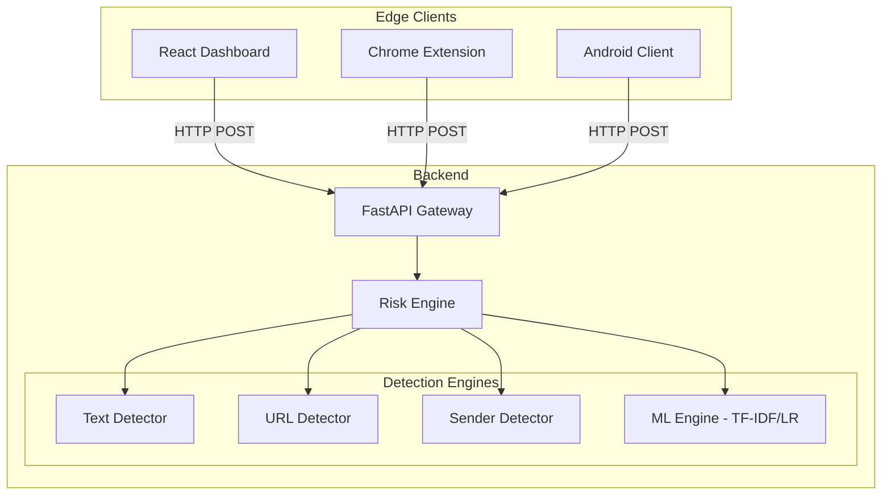

# Architecture: Phishing Shield AI

## High-Level System Architecture

Phishing Shield AI utilizes a centralized backend API serving multiple edge clients.

## Hybrid Detection Model

The core innovation is the Hybrid Risk Engine:
1. **Machine Learning Pipeline:** Utilizes TF-IDF vectorization and Logistic Regression for semantic understanding of text.
2. **Deterministic Heuristics:** Uses rule-based engines (RegEx, string parsing) for URL security and explicit keywords.
3. **Weighting Algorithm:** Combines the highest probability threat vectors into a final 0-100 risk score.
